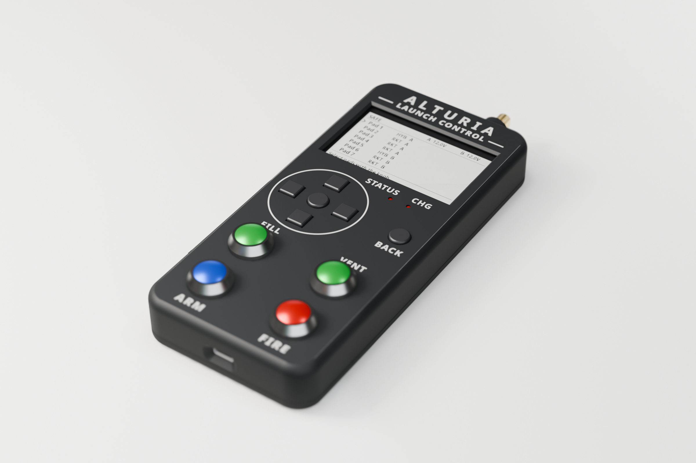
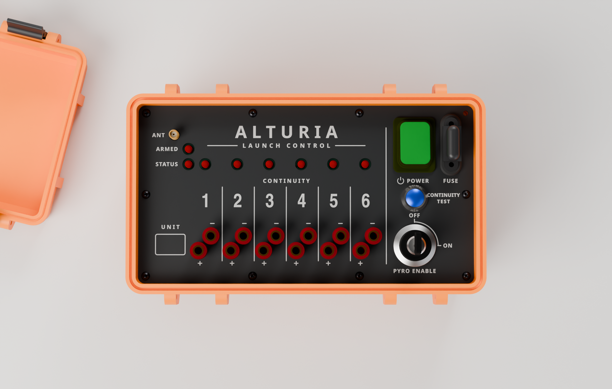
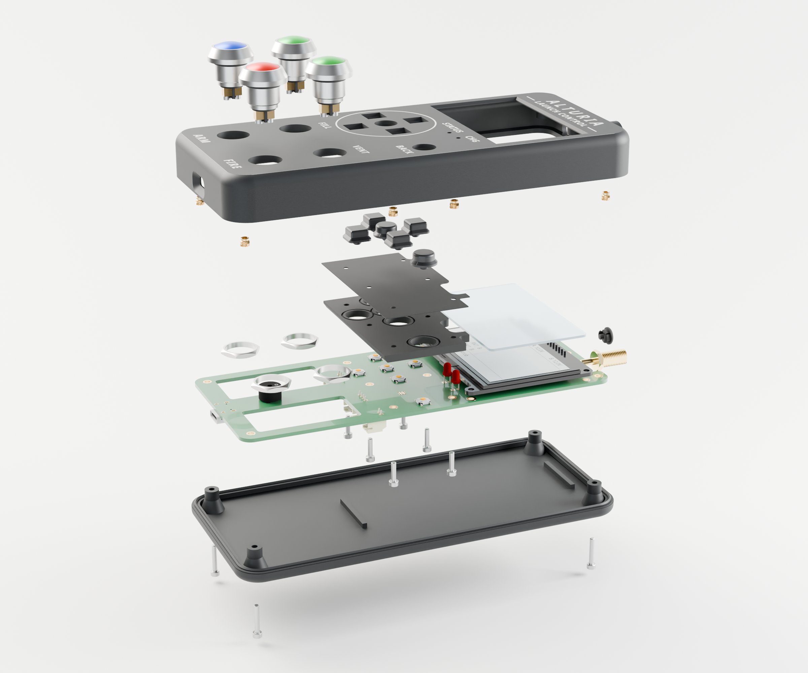
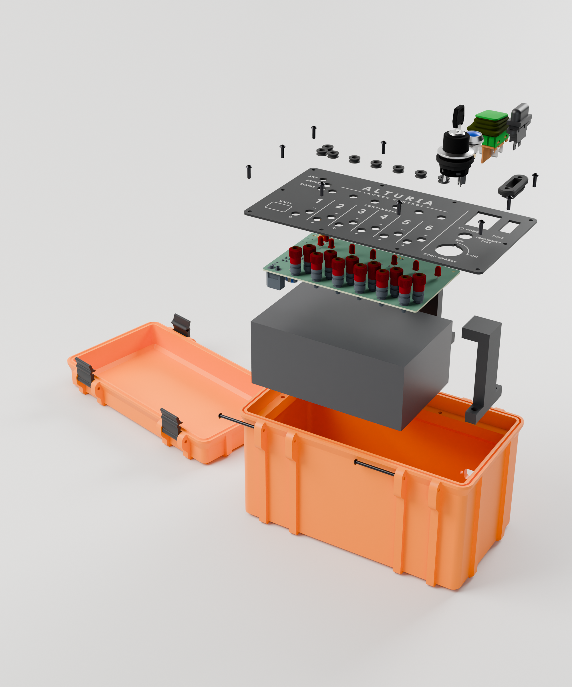

<p align="center">
  <picture>
    <source media="(prefers-color-scheme: dark)" srcset="design/logo/liftoff/alturia-launch-control-liftoff-reversed.svg">
    
  </picture>
</p>

# Alturia Launch Control

Alturia Launch Control is a wireless launch system for amateur rocketry.
You hold a handheld controller. At the pads stand up to eight satellites,
each with six channels for igniters or hybrid fill and vent valves, so one
controller handles up to 48 pads. Controller and satellites talk over an
encrypted LoRa link.

<p align="center">
  
  
</p>
<p align="center">
  
  
</p>

## Highlights

- **Four switches in series per channel.** Current flows through an igniter
  only when all four are closed: the key relay K2 (driven directly by the key
  switch on the satellite), the arm relay K1, the channel's high-side switch
  and its low-side MOSFET. Arming closes only K1. The two MOSFETs close
  together for the 1 s fire pulse and at no other time.
- **Self-test on arm.** The satellite detects welded relays and failed
  MOSFETs and refuses to arm a channel that fails.
- **Fails safe.** K1 is held by a monostable that the firmware has to
  retrigger every 80 ms, so a hung CPU drops it within about 150 ms. A
  satellite that hears nothing from the controller for 4 s goes SAFE. If the
  operator does nothing for 60 s, the controller disarms.
- **Precise continuity.** A test current of about 1.7 mA is measured with a
  24-bit ADC. That resolves a 1 to 2 Ω igniter from a short.
- **Secure radio link.** Pairing works like Bluetooth numeric comparison: an
  ECDH P-256 key exchange, then the operator checks that the LED pattern on
  the satellite matches the one on the controller's screen. After pairing,
  every frame is AES-128-CCM with replay protection. The link runs on
  869.85 MHz at 5 mW with no duty-cycle limit.
- **Field-ready hardware.** The controller has a sunlight-readable Sharp
  Memory LCD, a 1S LiPo and USB-C charging. The satellite sits in a
  waterproof 3D-printed case with an aluminium front panel and runs from a
  6 Ah LiFePO4 battery.

|          | Controller                         | Satellite                             |
|----------|------------------------------------|---------------------------------------|
| MCU      | ESP32-S3                           | STM32G474                             |
| Radio    | Wio-SX1262                         | Wio-SX1262                            |
| Firmware | Zephyr RTOS, LVGL UI               | Zephyr RTOS                           |
| Power    | 1S LiPo 4000 mAh, BQ24296M charger | LiFePO4 6 Ah                          |
| Display  | 400×240 Sharp Memory LCD           | 6 channel LEDs, status and armed LEDs |
| Controls | D-pad, ARM, FIRE, FILL, VENT, BACK | Key switch, continuity test button    |

## What's in the repo

```text
design/          design brief, schematic spec, radio security notes, logos
documentation/   write-ups: radio link, project overview (German), diagrams
hardware/
  controller/    pcb/ KiCad and fab outputs, cad/ FreeCAD case, D-pad, panel art,
                 renders, sim/ FEM and SPICE checks
  satellite/     pcb/ KiCad and fab outputs, cad/ FreeCAD case, front panel, renders
  parts/         vendor 3D models and datasheets shared by both boards
firmware/
  controller/    operator console (ESP32-S3 or native_sim)
  satellite/     pad-side satellite (STM32G474)
  common/        LoRa backend, secure link, wire format, buzzer chime
  boards/        out-of-tree Zephyr boards alturia_controller, alturia_satellite
  lora_bench/    link bring-up on two Heltec WiFi LoRa 32 V4 boards
tools/radiosim/  radio network simulator with web UI
```

Good places to start:

- [documentation/radio_link.md](documentation/radio_link.md): the radio
  link as implemented, covering pairing, keys, frame format, channel access
  and commands.
- [documentation/forum_post.md](documentation/forum_post.md): an overview
  of the whole system, its operation and its safety concept (in German).
- [design/satellite_schematic_spec.md](design/satellite_schematic_spec.md):
  the satellite circuit at netlist level.
- [tools/radiosim/README.md](tools/radiosim/README.md): running the network
  without hardware.

## Status

Rev A of both boards has been built and is in bring-up. On the bench, the
satellite measures continuity and pairs with the controller over the air.
The controller firmware runs on its own hardware. The satellite's arm
state machine and command handling are still in progress. Nothing has flown
yet.

## Building

The firmware needs a Zephyr tree set up with `west`.

```sh
# Controller UI on the desktop, with an emulated display
west build -b native_sim firmware/controller && ./build/zephyr/zephyr.exe

# Controller hardware
west build -b alturia_controller/esp32s3/procpu -d build-board firmware/controller
west flash -d build-board

# Satellite hardware (USB DFU)
west build -b alturia_satellite -d build-board firmware/satellite
west flash -d build-board -r dfu-util
```

For board-specific details, see
[firmware/satellite/README.md](firmware/satellite/README.md) and
[firmware/lora_bench/README.md](firmware/lora_bench/README.md).